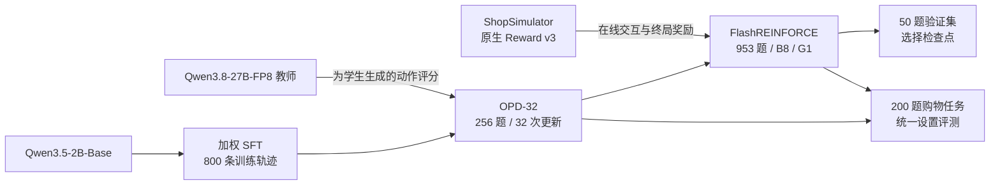

# ShopForge

训练一个能搜索商品、核对规格并完成购买的中文购物 Agent。

本项目以 **Qwen3.5-2B-Base** 为基础，在 ShopSimulator 购物环境中依次进行监督微调（SFT）、在线策略蒸馏（OPD）和强化学习（FlashREINFORCE）。仓库包含训练代码、固定数据划分、商品环境和评测工具，可用于研究小模型的多步工具调用、商品约束判断和交互效率。

[训练方法](#训练方法) · [实验结果](#实验结果) · [快速开始](#快速开始) · [数据与评测](#数据与评测)

**FlashREINFORCE 在 Final200 上达到 69.5% 的严格成功率（139/200）**，相比相同推理设置下的 OPD-32（66.0%）提升 **3.5 个百分点**，多完成 7 道购物任务。该成绩来自检查点回溯比较中的最高点 step912；最终 step1024 为 68.0%。下文同时报告完整曲线、操作步数和生成量。

## Agent 要完成什么任务？

ShopSimulator 是一个中文模拟购物环境。用户给出购买需求，Agent 通过工具操作商品页面，直到购买或终止。一次任务通常包含搜索、浏览候选、查看详情、选择规格和购买等多个步骤，最多执行 35 步。

例如，用户要求一件指定品牌、颜色、尺码且不超过预算的商品，Agent 就需要从搜索结果中找到候选，确认详情和可选规格，再选择对应款式。买到同类商品却选错尺码，仍然会导致任务失败。

仓库内嵌 Environment v2.1 的源码与压缩商品数据，采用 Reward v3 评分。SFT/OPD 与 Flash 分别使用各自目录中的环境服务；Flash 环境包含对规格文本中方括号的动作解析修复。

## 训练方法

三个阶段都使用 LoRA，即只训练附加在基础模型上的少量参数。SFT 先学习完整的购物操作，OPD 在学生自己的行为上引入教师反馈，FlashREINFORCE 再根据购物结果更新策略。



### SFT：学习可执行的购物行为

SFT（Supervised fine-tuning，监督微调）让模型学习已有购物轨迹中的回答和工具调用。用户输入、环境返回内容和填充位置不参与损失计算。默认配置对说明、一般工具调用、规格选择、购买片段分别使用 `1 / 1.5 / 1.5 / 2` 的损失权重，让模型更关注影响购买结果的动作。

训练使用 800 条轨迹、3 个 epoch、300 次优化器更新，LoRA `r=16 / alpha=32`，学习率 `1e-4`，最大序列长度为 `28,672` token。分段加权采用 SmartAD 的思路，数据使用本项目的固定训练集。

### OPD：在学生自己的轨迹上蒸馏

OPD（On-policy distillation，在线策略蒸馏）让学生先与环境交互，再由 Qwen3.8-27B-FP8 教师评价学生实际生成的 token。教师关闭 thinking，并使用固定的购物任务提示。学生据此调整动作概率，同时保留 SFT 约束。

OPD-32 从加权 SFT 模型开始，使用 256 道训练题，每批 8 题，更新 32 次。成功和失败轨迹均保留，每批新轨迹只更新一次。优化目标为即时 sampled reverse-KL 策略梯度估计，加 `0.1 ×` 加权 SFT 交叉熵约束，`discount=0`。学生采样、教师评分、学生训练分阶段加载，以控制显存占用。

### FlashREINFORCE：用环境奖励继续训练

FlashREINFORCE 从 OPD-32 出发，每题采样一条轨迹（G1），每批使用 8 个任务（B8），根据环境给出的终局奖励更新策略。实现用整批奖励均值作为基线，按 token 重要性比率计算损失，并用平均 Bernoulli KL 筛除策略变化过大的序列。

异步采样队列允许轨迹生成跨越参数更新，并记录每段轨迹使用的策略版本。有效失败的负奖励仍参与学习；若一批中有轨迹缺少可核验的终局奖励，则整批跳过。GRPO、GiGPO 入口也保留供算法对照。实现细节见 [FlashREINFORCE](flashreinforce/docs/flashreinforce.md) 和[异步调度](flashreinforce/docs/flashreinforce-async.md)。

## 实验结果

严格成功指 Agent 完成购买、命中任务指定的目标商品，并满足全部商品约束。失败、提前终止和奖励无法核验的任务均计入评测总数。下面分别列出 200 题开发集和 Final200 评测集的结果。

### SFT、OPD 与 FlashREINFORCE：200 题评测

Final200 是固定的 200 道购物任务，与训练数据按任务 ID 隔离。下表中的 OPD-32 与五个 FlashREINFORCE 检查点使用相同题序、提示、环境和推理设置：每题一条轨迹、贪心解码、seed42、单 worker 串行执行、eager 模式、关闭前缀缓存。每个模型均独立加载。

| 模型与训练配置 | 严格成功 | 平均环境奖励 | 平均环境步数 / 动作数 | 平均生成 token | 循环终止 |
|---|---:|---:|---:|---:|---:|
| Qwen3.5-2B Baseline | 0/200（0.0%） | -0.1105 | - | - | - |
| Qwen3.5-2B-Base + SFT（所有监督片段等权） | 121/200（60.5%） | 0.4729 | - | - | - |
| Qwen3.5-2B-Base + SFT（分段加权，默认配置） | 126/200（63.0%） | 0.52393 | 9.230 | - | - |
| OPD-32 | 132/200（66.0%） | 0.570138 | 6.155 | 168.935 | 11 |
| Flash step256 | 135/200（67.5%） | 0.580401 | 7.535 | 200.410 | 22 |
| Flash step512 | 135/200（67.5%） | 0.580631 | 7.535 | 204.505 | 23 |
| Flash step768 | 137/200（68.5%） | 0.585462 | 7.985 | 213.190 | 23 |
| **FlashREINFORCE step912** | **139/200（69.5%）** | **0.600693** | 7.755 | 209.110 | 23 |
| Flash 最终 step1024 | 136/200（68.0%） | 0.579009 | 7.730 | 218.715 | 28 |

`step` 表示从 OPD-32 开始累计执行的参数更新次数。平均环境步数衡量交互次数，平均生成 token 衡量模型输出量；循环终止指因重复操作而结束的任务数。

分段加权 SFT 的结果来自下文的 Transformers/PEFT 配对评测，9.230 为平均执行动作数；其提示与推理后端不同于此处的 OPD/Flash 评测。`-` 表示暂未提供的指标。

step912 的 **69.5%** 是本组最高成功率，平均环境奖励也最高，为 0.600693。相较 OPD-32，成功数从 132 增至 139，同时平均环境步数从 6.155 增至 7.755。

最终 step1024 相比 OPD-32 新增成功 11 题、退步 7 题，净增 4 题；平均步数增加 25.59%，token 增加 29.47%。最后 112 次更新净丢失 3 个成功，循环终止由 23 增至 28。

69.5% 是在同一 Final200 上比较多个检查点后得到的最高值，属于探索性结果。这组实验使用单个训练种子，未设置同预算同步训练对照，因此不能将差异单独归因于异步调度。训练在 step768 后重建过优化器，之后连续完成 256 次更新；表中的步数按累计权重更新计算。

### SFT 与 OPD：开发集结果

开发集包含从 SFT 数据中留出的 200 条任务轨迹，用于比较监督方式和蒸馏配置。它与 Final200 是不同题集，成功率应在各自表内比较。

| 模型与训练配置 | 严格成功 | 平均环境奖励 | 平均执行动作 |
|---|---:|---:|---:|
| Qwen3.5-2B-Base（未微调） | 1/200（0.5%） | - | 3.515 |
| Qwen3.5-2B-Base + SFT（所有监督片段等权） | 171/200（85.5%） | 0.8264 | 7.805 |
| Qwen3.5-2B-Base + SFT（分段加权，默认配置） | 178/200（89.0%） | 0.8790 | 7.745 |
| Qwen3.5-2B-Base + SFT（在默认配置上将规格选择权重提高至 2） | 176/200（88.0%） | 0.8645 | 7.780 |
| 默认加权 SFT + OPD（蒸馏更新 8 次） | 181/200（90.5%） | 0.89744 | 7.565 |
| 默认加权 SFT + OPD（蒸馏更新 32 次） | 179/200（89.5%） | 0.87668 | 5.255 |

三种 SFT 配置分别从基础模型训练；OPD-8 和 OPD-32 分别从默认加权 SFT 模型开始。OPD-32 比加权 SFT 多成功 1 题，平均动作减少 32.15%。教师在同一开发集上的成绩为 183/200（91.5%），平均 4.880 个动作。

SFT 与 OPD 还在 Final200 上做过一组配对比较，使用相同的 SFT/OPD 提示及 Transformers/PEFT 推理：

| 模型 | 严格成功 | 平均奖励 | 平均执行动作 |
|---|---:|---:|---:|
| 加权 SFT | 126/200（63.0%） | 0.52393 | 9.230 |
| OPD-32 | 132/200（66.0%） | 0.57028 | 5.910 |

这一设置下，OPD-32 的成功率增加 3 个百分点，平均动作减少 36.0%。这组比较的提示与推理后端不同于上面的 Flash 评测，步数和奖励应在各自设置内比较。

### RL 验证集上的对照

在固定的 50 题 RL 验证集上，OPD-32、GRPO-64、GiGPO-64、同步 Flash-64 的评测结果均为 30/50（60%）。训练端增加规格违规惩罚的 GRPO-64 为 32/50（64%）。这里的 64 表示参数更新次数，这些对照的结果覆盖验证集。

最终 Flash1024 与 OPD-32 在独立加载、串行 eager 设置下的配对评测也同为 30/50；Flash 平均环境步数为 8.12，OPD 为 6.86。

## 数据与评测

| 数据 | 数量 | 用途与位置 |
|---|---:|---|
| SFT train | 800 条轨迹 | `sft/data/sft/train.jsonl` |
| SFT development | 200 条轨迹 | `sft/data/sft/validation.jsonl` |
| OPD-32 train | 256 题 | SFT 训练集的固定子集；`opd/assets/historical-opd32-task-ids.jsonl` |
| RL train | 953 题 | `flashreinforce/outputs/preparation/v1/candidate-price953/train953.parquet` |
| RL validation | 50 题 | `flashreinforce/data/grpo/validation.parquet` |
| Final200 | 200 题 | `sft/data/evaluation/tasks.jsonl` |

OPD 的 256 题排除了开发集、Final200 和 50 道教师提示校准题。RL 训练池与 SFT 训练、开发及 RL 验证集按 task_id 隔离，Final200 与这些训练和验证集也无 task_id 重叠。本地验证工具会检查这些关系。

Reward v3 根据实际购买结果和环境证据计算分数，无需调用另一个模型作为裁判。品类与预算为硬门槛；品牌、型号、核心功能、关键规格的权重为 `0.35 / 0.25 / 0.25 / 0.15`。完全满足要求的目标商品奖励为 `1.0`，完全满足要求的替代商品为 `0.55`。替代购买可以得到正奖励，严格成功则只计 `gold_purchase`。规则和终止条件见 [Reward v3](sft/docs/reward-v3.md)。

## 快速开始

以下 Bash 命令在项目根目录执行。训练需要 Linux、NVIDIA GPU、匹配的 CUDA 驱动和 `uv` 包管理工具。根目录准备工具使用 Python 3.11 或更高版本。仓库包含训练数据和压缩商品库；基础模型与教师模型的权重需下载到本地并填写路径。

```bash
git clone https://github.com/My13ad/shopforge.git
cd shopforge
```

### 1. 配置模型与运行路径

```bash
cp configs/paths.example.json configs/paths.local.json
```

编辑 `configs/paths.local.json`，填入本地基模、教师模型和各阶段 Python 路径。相对路径均从项目根目录解析。

| 配置项 | 内容 |
|---|---|
| `models.base` | `Qwen3.5-2B-Base` 的本地模型目录 |
| `models.teacher` | `Qwen3.8-27B-FP8` 的本地模型目录 |
| `python.sft` | SFT/OPD 客户端 Python；示例为 `.venvs/sft/bin/python` |
| `python.teacher` | 已准备的独立教师服务 Python |
| `python.flash` | 设置为 `flashreinforce/.venv/bin/python`，与补丁脚本的路径检查一致 |
| `shop_urls.sft` / `shop_urls.flash` | 默认分别为 `http://127.0.0.1:5700` 和 `http://127.0.0.1:5721` |

`sft_adapter`、`sft_reference`、`opd_adapter` 和 `runs` 控制阶段产物路径。保留默认值即可衔接后续步骤。

### 2. 准备独立依赖环境

使用 `uv` 创建 SFT/OPD 客户端与 Flash 环境：

```bash
uv venv --python 3.12 .venvs/sft
uv pip install --python .venvs/sft/bin/python -r requirements/sft-client.txt
uv pip install --python .venvs/sft/bin/python --no-deps -e ./sft

uv venv --python 3.12 flashreinforce/.venv
uv pip install --python flashreinforce/.venv/bin/python -e './flashreinforce[grpo]'
flashreinforce/.venv/bin/python flashreinforce/scripts/apply_verl_dynamic_sampling_patch.py
```

SFT/OPD 客户端固定 Torch `2.8.0+cu128`；Flash 固定 Torch `2.11.0`、veRL `0.8.0`、vLLM `0.25.1`、Ray `2.56.1`。两个阶段使用独立的 `PYTHONPATH`，由预览工具给出。

OPD 还需要独立的 vLLM 教师环境，将其 Python 路径填入 `python.teacher`。教师接口须返回学生实际采样 token 的条件对数概率，并通过 token ID 对齐检查。教师端尚未提供完整的依赖锁文件，需按[环境准备](docs/setup.md)中的要求配置和验证。

### 3. 准备并启动 ShopSimulator

环境服务单独安装依赖。下面使用 Python 3.11，以满足根目录准备工具的要求：

```bash
uv venv --python 3.11 .venvs/shopsim
uv pip install --python .venvs/shopsim/bin/python \
  -r sft/environments/ShopSimulator/shop_env/requirements.txt

.venvs/shopsim/bin/python tools/prepare_environment.py --stage sft --build-index
.venvs/shopsim/bin/python tools/prepare_environment.py --stage flashreinforce --build-index
```

准备工具在 CPU 上校验压缩包、解压商品文件并建立 SQLite 搜索索引。随后在独立终端启动对应服务：

```bash
# SFT / OPD 环境
PATH="$PWD/.venvs/shopsim/bin:$PATH" SHOPSIM_PORT=5700 \
  bash sft/environments/ShopSimulator/shop_env/start.sh
```

```bash
# Flash 环境：40 个槽位用于异步采样及验证
PATH="$PWD/.venvs/shopsim/bin:$PATH" SHOPSIM_PORT=5721 SHOPSIM_ENV_SLOTS=40 \
  bash flashreinforce/environments/ShopSimulator/shop_env/start.sh
```

### 4. 按顺序预览并执行各阶段

```bash
python tools/preview.py sft --config configs/paths.local.json
python tools/preview.py sft-reference --config configs/paths.local.json
python tools/preview.py opd32 --config configs/paths.local.json
python tools/preview.py flashreinforce --config configs/paths.local.json
```

`preview.py` 只打印命令。输出 JSON 中，`cwd` 是工作目录，`env` 是要设置的环境变量，`argv` 是完整命令的参数数组，`unresolved_inputs` 列出缺少的输入。实际运行时，切换到对应目录、设置环境变量，再执行命令。每完成一阶段，重新生成下一阶段预览。

| 阶段 | 默认产物 | 下一步如何使用 |
|---|---|---|
| `sft` | `runs/sft-e1/adapter` | 供参考评测和 OPD 初始化 |
| `sft-reference` | `runs/sft-reference` | 保存 SFT 模型的开发集评测结果，供 OPD 使用 |
| `opd32` | `runs/opd32/round-32/training/adapter` | 作为 Flash 父模型 |
| `flashreinforce` | `runs/flash-from-opd32` | 从 `checkpoint_selection/best-checkpoint.json` 读取选中模型 |

SFT 训练完成后，先执行 `sft-reference`。OPD 会检查输入权重与这份评测结果是否对应。Flash 预览默认附带 `--dry-run`，用于检查配置；准备好输入并通过运行时检查后，去掉该参数即可启动训练。

默认 Flash 配置最多训练 256 次更新，每 64 次验证。完成至少 128 次更新后，连续 3 次验证未改善则早停，同分保留更早检查点。上文的 1024 步结果使用了更长的训练预算。最佳 LoRA 权重用于推理；恢复训练还需要对应的优化器检查点。阶段参数和输入关系见[流水线说明](docs/pipeline.md)。

### 5. 本地检查

```bash
python -X utf8 tools/verify_local.py
python -X utf8 -m pytest tests -q
```

`-X utf8` 使 Windows 和 Linux 都按 UTF-8 读取中文元数据。校验工具检查源码语法、数据划分和环境文件；根目录测试覆盖阶段衔接、模型权重匹配和固定任务清单。SFT、OPD 和 Flash 的模块测试位于各自目录中。

## 资源开销参考

下表给出实际实验耗时和内存观测值。PyTorch 分配、PyTorch 保留和整卡占用分别列出，便于估算部署资源。

| 实验 | 耗时 | 记录的资源峰值 |
|---|---|---|
| 加权 SFT，300 次更新 | 训练约 254.4 分钟；开发评测约 29.67 分钟 | 训练分配 17.35 GiB；整卡约 21.29 GiB |
| OPD-32、SFT 对照及两组开发评测 | 完整流程约 211.15 分钟 | 学生训练分配 11.43 GiB；全流程整卡 43.56 GiB |
| 独立异步 Flash256 | 含初始化、验证、导出约 1 小时 56 分钟 | 训练分配 / 保留 47.59 / 59.60 GiB |

这些是已完成运行的观测值，硬件规划还需为教师服务、推理缓存、模型导出和检查点归档留出空间。

## 目录与文档

```text
configs/          模型、Python、服务和输出路径示例
sft/              加权 SFT、训练数据、评测工具与购物环境
opd/              OPD 训练、教师评分和固定任务清单
flashreinforce/    强化学习训练、异步采样、检查点选择与购物环境
requirements/     SFT / OPD 客户端依赖
tools/            命令预览、环境准备与本地校验
tests/            跨阶段衔接测试
docs/             安装与运行说明
provenance/       源码版本与数据来源信息
```

| 文档 | 内容 |
|---|---|
| [流水线](docs/pipeline.md) | SFT → 参考评测 → OPD → Flash 的输入与产物 |
| [环境准备](docs/setup.md) | 依赖隔离、商品索引和 CPU 检查 |
| [Reward v3](sft/docs/reward-v3.md) | 约束评分、终局奖励与终止条件 |
| [Flash 算法](flashreinforce/docs/flashreinforce.md) / [异步实现](flashreinforce/docs/flashreinforce-async.md) | 损失、整批准入、队列及策略版本管理 |

项目使用 Qwen 模型、ShopSimulator 购物环境和 veRL 训练框架。SFT 分段加权参考 SmartAD，FlashREINFORCE 的实现与上游源码对应关系见[算法说明](flashreinforce/docs/flashreinforce.md)。

## 开源协议

ShopForge 的原创代码采用 [Apache-2.0](LICENSE)。第三方源码、商品数据及模型遵循各自的许可条款，来源与适用范围见 [第三方说明](THIRD_PARTY_NOTICES.md)。
